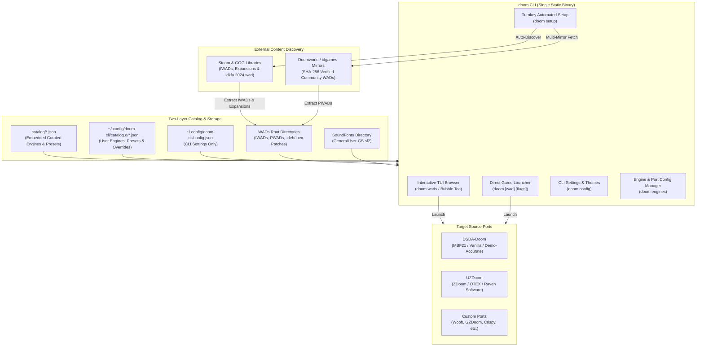

# Contributing to doom-cli

This document outlines the repository standards, architectural guidelines, modular package layout, development
workflow, testing requirements, and pull request conventions for `github.com/lock14/doom-cli`.

## Repository design principles

All contributions must respect the core repository invariants:

*   **Declarative entity catalog and single source of truth**: All curated engine and preset definitions, IWAD
    mappings, PWAD file lists, DeHackEd orderings, metadata, and download URLs are defined one entity per file in
    [`catalog/`](catalog/) (`engine.<id>.json` and `preset.<id>.json`) and embedded directly via the root
    [`embed.go`](embed.go). Use `doom wads lint` to validate schema and invariants, and `doom wads build` to
    synchronize `README.md`.
*   **Portability and path invariants**:
    *   **Never commit personal user paths, display resolutions, or refresh rates**: Do not commit paths like
        `/home/<username>/`, hardcoded display resolutions, or fixed monitor refresh rates into configurations, presets,
        or code.
    *   **Use placeholder tokens**: Use `__RESOLUTION__`, `__REFRESH_RATE__`, and `__SOUNDFONT__` in
        engine configuration templates (`dsda-doom/dsda-doom.cfg`, `uzdoom/autoexec.cfg`). The CLI deployment tooling
        dynamically substitutes these based on runtime display and filesystem detection.
    *   **Standard directory structures**: Respect platform standard directories (XDG on Linux,
        `~/Library/Application Support/` on macOS, and `%LOCALAPPDATA%` and `%USERPROFILE%\Games\Doom\` on Windows).
*   **Destructive safety and backup policy**: Any configuration or catalog write (`doom engines cfg install`,
    `doom engines install`, `doom setup`, `doom config set`, `doom engines add`, `doom engines set`, `doom wads add`,
    `doom wads set`, and `Ctrl+S` in the TUI `Launch Options` and `Configuration Manager` views) must write atomically
    and generate non-clobbering timestamped backups (`.bak.<timestamp>`, retaining at most `MaxBackupsPerFile = 3` per
    file and cleaning up backups via `fsutil.RemoveBackups` on entity or override deletion, in-TUI `Ctrl+R` resets, and
    repository templates during `doom engines cfg sync`) before overwriting any existing user file.
    `fsutil.WriteFileAtomic`, `fsutil.WriteReaderAtomic`, `fsutil.CopyFileAtomic`, and `fsutil.DownloadVerified` share
    `writeReaderTempAndRename`, which streams to a same-directory `.doom-tmp-*` file, applies `Chmod`, `Sync`, and
    `Close`, and runs any validation callback (including SHA-256 verification) before calling `fsutil.BackupFile` and
    `os.Rename` so failed or corrupt writes never create spurious `.bak.*` files.
*   **Verified HTTP downloads and archive security**: All outbound HTTP downloads (`engine.Installer`,
    `wad.Downloader`, and `wad.InstallSoundFontURL`) must use `fsutil.DownloadVerified` and `fsutil.UserAgent`
    (`"doom-cli/2.0"`). All archive extractions (`archive/zip`), direct downloads, and relative sub-path resolutions
    must sanitize entry paths against `..` traversal sequences via `fsutil.SafeJoin` and verify containment before any
    filesystem write.
*   **Two-tier settings precedence**: CLI settings (`theme`, `nerd-fonts`, `wads-dir`, `wads-dirs`, `bin-dir`, and
    `soundfonts-dir`) resolve in a strict two-tier hierarchy (`config` in `config.json` takes precedence over platform
    `default` values), with `DOOM_CONFIG_DIR` as the sole application environment variable and zero global persistent
    flags or per-setting `DOOM_*` environment variables.
*   **Doom engine selection and preset hygiene**:
    *   **DSDA-Doom**: Use for classic vanilla, Boom, MBF, and MBF21 maps where demo accuracy, standard physics,
        and speedrunning precision are desired (such as *Alien Vendetta*, *AUGER;ZENITH*, *BTSX*, *Going Down Turbo*,
        *Overboard*, *Rowdy Rudy II*, *Sunder*, *Sunlust*, *Legacy of Rust*, and *Sigil*).
    *   **UZDoom**: Use for mapsets requiring ZDoom or GZDoom scripting (*MyHouse.pk3*), high-resolution texture packs
        like OTEX (*Eviternity I & II*), or Raven Software and Rogue Entertainment games (*Heretic*, *Hexen*, *Strife*).
    *   **Curated edition policy and taxonomy metadata**: Every curated preset in `catalog/preset.<id>.json` must
        declare `genre`, `difficulty`, `quality`, and `links` (with `PrimaryURL()` rendered as a clickable title link in
        `README.md` and surfaced alongside `Engine`, `Genre`, `Difficulty`, and `Quality` in `doom wads list`,
        `doom wads show`, and the interactive TUI preview pane and fuzzy filter). When a mapset has an author-sanctioned
        rebalanced edition (such as *Going Down Turbo* (`gdturbo.wad`), `mouldy`'s 2024 10th-anniversary remaster of
        *Going Down* (`gd.wad`)), curate the definitive edition rather than duplicating both versions, and route
        shorthand queries (`doom gd`, `doom going-down`) to the canonical preset via `NormalizePresetQuery`.
    *   **No duplicate IWADs**: Never include the base game IWAD in `files`. The IWAD must only be specified in `iwad`.
    *   **Unified launch argument and preview synthesis**: `PrepareLaunch` and `FormatLaunchPreview` share
        `resolveEngineConfig` and `buildEngineArgs` so argument ordering (`PrefixArgs`, `-iwad`, `-file`, `-deh`,
        `DefaultArgs`, preset `Args`, `ExtraArgs`), `LoadMapsAfterMods` sorting, and missing optional file omission
        (when `idx != nil`) never diverge between live execution, `doom wads show`, and the TUI `Launch Options`
        command preview.
    *   **Four-tier preset readiness and acquisition predicates**: `DirIndex.IsPresetInstalled` checks the base IWAD
        plus required files for launch readiness and search indexing; `DirIndex.ArePresetFilesInstalled` checks
        required files only for `wad.Downloader` (reusing a single `DirIndex` across `DownloadAll` and rebuilding only
        when an archive downloads); `DirIndex.NeedsSteamDiscovery` checks for no download sources, a missing IWAD, or
        missing optional files to gate Steam and GOG extraction during `doom wads fetch <name>` and TUI `Ctrl+F`; and
        `areAllPresetFilesPresent` checks the IWAD plus all required and optional files so TUI `Ctrl+F` runs when only
        optional assets like `idkfa 2024.wad` are missing, with all `FileSpec` lookups routed through
        `DirIndex.ResolveFileSpec`.
    *   **Filename and preset query normalization and declarative aliases**: Maintain case-insensitive and dash-,
        underscore-, and space-tolerant file resolution (`preset.NormalizeFilename`) across WAD roots, archive
        extraction, and Steam and GOG discovery, alongside tiered preset query resolution (`Catalog.Find`,
        `Catalog.FindExact`, and `preset.NormalizePresetQuery`) across WAD stems, Roman numerals, implicit `doom`
        prefixes, and multi-word initialisms. When an upstream archive or rerelease uses a distinct filename stem,
        declare `"aliases"` on the `FileSpec` in `catalog/preset.<id>.json` so both `preset.DirIndex` and
        `steam.DefaultTargetPatterns()` derive from a single source of truth.
    *   **Two-layer catalog**: Curated defaults in `catalog/*.json` are immutable; user engines, presets, and overrides
        layer cleanly as individual drop-in files in `<ConfigDir>/catalog.d/*.json`, while `<ConfigDir>/config.json`
        stores CLI settings only.

## Architecture and modular package layout



The repository features a unified, zero-dependency Go CLI (`doom`) that compiles to a single static binary:

```
doom-cli/
├── embed.go                # Single root embed.FS (catalog/*.json, dsda-doom/*.cfg, uzdoom/*.cfg)
├── catalog/                # One-entity-per-file curated catalog (engine.<id>.json, preset.<id>.json)
├── cmd/doom/               # Command-line interface definitions using Cobra
│   ├── main.go             # Entrypoint, root direct game launcher, path and catalog helpers
│   ├── wads.go             # 'doom wads' TUI browser (list, show, fetch, scan, add, set, reset, remove, lint, build)
│   ├── engines.go          # 'doom engines' TUI manager (list, install, add, set, reset, remove, cfg)
│   ├── config.go           # 'doom config' interactive TUI settings editor and subcommands (show, get, set, themes)
│   └── setup.go            # 'doom setup' turnkey installation workflow
├── internal/
│   ├── config/             # Platform path resolvers (paths.go) and settings-only config.json (settings.go)
│   ├── display/            # Native display resolution and refresh rate auto-detection
│   ├── engine/             # Source port runners, argument synthesis, declarative binary installers
│   │   ├── runner.go       # Launch synthesis (PrepareLaunch), zero-I/O preview (FormatLaunchPreview), and execution
│   │   └── installer.go    # Declarative GitHub release and pinned fallback binary installer
│   ├── fsutil/             # Atomic writes, backups, SHA-256 verified HTTP downloads (DownloadVerified), and SafeJoin
│   ├── preset/             # Two-layer entity catalog, store, linter, file resolver, README compiler
│   │   ├── preset.go       # Entity models, strict decoding, layered catalog loader, quarantine
│   │   ├── store.go        # User catalog.d write operations (AddEngine, ConfigEngine, AddPreset, ConfigPreset)
│   │   ├── lint.go         # Schema, invariant, personal-path, README parity, and documentation linter
│   │   ├── resolve.go      # Multi-root DirIndex, relative sub-path, 1-level subdir, readiness, and README resolver
│   │   ├── decode.go       # Robust text decoding with CP437 and DOS box-drawing character detection
│   │   └── compiler.go     # Synchronizes curated catalog/*.json into README.md
│   ├── steam/              # Steam and GOG discovery, catalog target synthesis, and idkfa 2024.wad synthesis
│   ├── templates/          # Embedded engine configuration templates and backup deployer
│   ├── tui/                # Terminal user interface components powered by Bubble Tea and Lip Gloss
│   │   ├── launcher.go     # Bubble Tea state machine, update loop, in-TUI asset fetch, and message routing
│   │   ├── options.go      # Unified launch options and per-preset configuration view (Ctrl+O or F4)
│   │   ├── config_view.go  # 3-tab in-TUI configuration manager (Ctrl+G or F2)
│   │   ├── layout.go       # Dynamic viewport and responsive pane geometry calculations
│   │   ├── render.go       # Split-pane UI rendering, badges, contextual help (F1), and key help formatting
│   │   ├── menu.go         # Fallback numbered terminal menu for basic or non-TTY environments
│   │   ├── theme.go        # Theme loading, custom JSON theme decoding, and ANSI and TrueColor styles
│   │   └── builtin_themes.go # Curated color palettes adhering to the 60-30-10 design principle
│   └── wad/                # WAD downloading, archive extraction, and SoundFont deployment
│       ├── downloader.go   # Multi-mirror SHA-256 verified downloader for community megawads
│       ├── extract.go      # Zip Slip hardened extractor, DEHACKED lump extractor, and ranked README extractor
│       └── soundfont.go    # Roland SC-55 SoundFont installer
├── .agents/                # Scoped conditional TUI rules and mono-tui v0.2.5 design and audit skills
│   ├── rules/              # Project overrides and conventions (monospace-tui.md)
│   └── skills/             # TUI design and audit skills (mono-tui-design/, mono-tui-audit/)
├── dsda-doom/              # DSDA-Doom configuration template with placeholder tokens
└── uzdoom/                 # UZDoom autoexec configuration template with placeholder tokens
```

## Developer how-to guides

### Adding or promoting a curated preset

Because user entities in `<ConfigDir>/catalog.d/preset.<id>.json` share the exact same schema as curated entities in
`catalog/preset.<id>.json`, you can test a new preset locally and promote it directly into the repository:

1. Add and test the preset locally using the CLI, or create `catalog/preset.<id>.json` directly:
   ```json
   {
     "schema_version": 1,
     "kind": "preset",
     "id": "my-mapset",
     "name": "My Mapset",
     "engine": "dsda-doom",
     "iwad": "DOOM2.WAD",
     "files": [
       { "name": "mymap.wad" },
       { "name": "mymap.deh" },
       { "name": "idkfa 2024.wad", "optional": true }
     ],
     "category": "Community Megawad",
     "genre": "Run-and-Gun",
     "difficulty": "Hard",
     "quality": "S-Tier (9.5/10)",
     "compatibility": "Boom",
     "description": "Short description of the mapset and compatibility",
     "author": "Author Name",
     "release_date": "2024",
     "sources": [
       {
         "url": "https://youfailit.net/pub/idgames/levels/doom2/Ports/m-o/mymap.zip"
       }
     ],
     "links": [
       {
         "url": "https://www.doomworld.com/idgames/levels/doom2/Ports/m-o/mymap",
         "rel": "idgames"
       }
     ],
     "sort": 330
   }
   ```
   - **Promote from user catalog**:
     ```bash
     cp ~/.config/doom-cli/catalog.d/preset.my-mapset.json catalog/preset.my-mapset.json
     ```
     Then ensure `author`, `release_date`, `category`, `genre`, `difficulty`, `quality`, `links`, and a unique positive
     `sort` integer (spaced by 10s in display order) are set.
   - **IWAD separation**: Do not include the base game IWAD in `files`.
   - **Canonical archive filenames and aliases**: `files[].name` must match the exact canonical filename inside the
     upstream `.zip` archive (`Eviternity II.wad`, `Sunder 2512.wad`, `SODfinal.wad`, `aaliens.wad`, `scythe.wad`,
     `TNTR.WAD`), while `files[].aliases` is reserved strictly for genuine external distribution or Steam and GOG
     rerelease filename stems (`sigil.wad`, `sigil2.wad`, `sigil_ii.wad`, `sunder.wad`).
   - **Source URLs**: Every `sources[].url` must use `https://` and end in `.zip`, `.wad`, or `.pk3`; Doomworld web
     pages belong in `links[]` with `"rel": "idgames"`.
2. Synchronize the `README.md` preset table and run the catalog linter:
   ```bash
   go run ./cmd/doom wads build
   go run ./cmd/doom wads lint
   ```
3. Verify catalog invariant tests pass:
   ```bash
   go test -v -race ./internal/preset/...
   ```

### Adding or promoting a curated engine

1. Create `catalog/engine.<id>.json` (or copy from `~/.config/doom-cli/catalog.d/engine.<id>.json`) with
   `kind: "engine"`, `id`, `display_name`, `description`, `family`, `args_style` (`"boom"` or `"zdoom"`), `binary`,
   `badge`, and optional `install` recipe.
2. Run `go run ./cmd/doom wads lint` and `go test -v -race ./...`.

### Adding a built-in theme

1. Open `internal/tui/builtin_themes.go`.
2. Define a new `Theme` entry in `BuiltinThemes` and `ListBuiltinThemes`:
   - **60-30-10 design principle**:
     - **60% canvas neutral**: `Muted`, `KeyDesc`, and background surfaces.
     - **30% structural framing**: `BorderActive`, `BorderInactive`, `TitleActive`, `TitleInactive`, `Label`,
       `TagDSDA`, and `TagUZDoom`.
     - **10% focused accent**: `BrandCap`, `BrandText`, `BrandBg`, `Prompt`, `CursorBar`, `CursorText`, and `Keycap`.
   - Ensure high contrast for readability across dark terminal backgrounds.
3. Update the theme list in `README.md` and `llms.txt`.
4. Test with:
   ```bash
   go run ./cmd/doom config themes
   go run ./cmd/doom config set theme <new_theme>
   go run ./cmd/doom wads
   ```

### Synchronizing engine configuration templates

When refining the curated engine configurations (`uzdoom/autoexec.cfg` and `dsda-doom/dsda-doom.cfg`) after testing
in-game settings on a local machine, use the hidden maintainer command `doom engines cfg sync`:

1. Inspect differences between the repository templates and your installed system configurations:
   ```bash
   go run ./cmd/doom engines cfg diff
   ```
2. Pull live tweaks back into `uzdoom/autoexec.cfg` and `dsda-doom/dsda-doom.cfg` (automatically restoring
   `__RESOLUTION__`, `__REFRESH_RATE__`, and `__SOUNDFONT__` placeholder tokens):
   ```bash
   go run ./cmd/doom engines cfg sync
   ```
3. Verify no personal paths were introduced:
   ```bash
   go run ./cmd/doom wads lint
   ```

### Archive security (Zip Slip and path containment)

When extracting archives (`archive/zip`) or joining relative paths under a root directory, always use
`fsutil.SafeJoin(root, rel)` or verify containment against `filepath.Clean(targetDir) + string(filepath.Separator)`
before any filesystem write.

## Development setup and Makefile targets

### Prerequisites

*   Go 1.27.0 or higher
*   GNU Make
*   Git

### Developer Makefile targets

The repository includes a `Makefile` for developer verification and local builds:

| Target | Command | Description |
| :--- | :--- | :--- |
| `make build` | `go build -o bin/doom ./cmd/doom` | Compiles the `bin/doom` static binary |
| `make install` | `cp bin/doom $(PREFIX)/doom` | Builds and installs binary to `~/.local/bin/doom` |
| `make test` | `go test -v -race -shuffle=on ./...` | Runs test suite under race detector with randomized order |
| `make bench` | `go test -bench=. -benchmem ./...` | Runs performance benchmarks with allocation tracking |
| `make lint` | `go vet && revive` | Performs static analysis via `go vet` and Revive |
| `make format` | `gofmt -s -w .` | Simplifies and formats all Go source files |
| `make tidy` | `go mod tidy && git diff` | Tidies and verifies `go.mod` and `go.sum` hygiene |
| `make check` | Full test and lint pipeline | Runs formatting, tidy, linters, tests, and path invariant audit |
| `make clean` | `rm -rf bin` | Cleans temporary build artifacts |
| `make help` | Target list | Displays available developer targets |

## Go code style and quality standards

*   **Formatting**: Always format code using `gofmt -s -w .` (simplifying slice and composite literal syntax).
*   **Maximum line length (120 columns)**: Enforce a strict 120-character maximum line length limit across the
    repository via `.editorconfig` and Revive's `line-length-limit` rule in `revive.toml`. Long strings, command
    invocations, and error messages must be wrapped cleanly.
*   **Receiver naming**: Use short (1 to 2 letters), mnemonic receiver names consistently across methods on a type.
    Never use `this` or `self`.
*   **Avoid identifier shadowing**: Never shadow Go built-in identifiers (`min`, `max`, `len`, `cap`, `new`,
    `clear`, `copy`, `close`, `delete`). Use descriptive identifiers such as `maxVal`, `count`, or `limit`.
*   **Documentation comments**: All exported packages, types, interfaces, constants, and functions must have
    comprehensive Go doc comments starting with the symbol name and adhering to standard Go and `revive` conventions.
*   **Static analysis**: Code must pass `go vet ./...` and `revive -config revive.toml -formatter friendly ./...`
    with zero warnings.

## Testing conventions

*   **Table-driven tests**: Use table-driven tests for unit testing with descriptive test case names.
*   **Hardened concurrency and randomization**: All tests must pass cleanly under `-race` (race detector) and
    `-shuffle=on` (test order randomization).
*   **Filesystem isolation**: File resolution, deployment, and extraction tests must execute within isolated
    temporary directories (`t.TempDir()` or `os.MkdirTemp`) and clean up completely.
*   **Catalog lint and path invariant test**: Every test run includes automated validation that:
    1. Curated entities in `catalog/*.json` pass strict schema validation and synchronize with `README.md`.
    2. Zero absolute personal user paths exist in configuration files, catalog entities, documentation, or test
       fixtures.

## Documentation boundaries and synchronization

*   **User-facing documentation**: `README.md` focuses strictly on user-facing installation, directory layouts, preset
    catalogs, visual profiles, and `doom` CLI usage. Must not contain internal developer commands or compiler details.
*   **Contributor-facing documentation**: `CONTRIBUTING.md` covers developer setup, `make` targets, code style,
    modular package maps, how-to guides, and pull request guidelines.
*   **Agent and architectural invariants**: `AGENTS.md` encodes canonical design invariants, path tokens, safety
    rules, technical writing and typography conventions, and automated verification checklists.
*   **Mandatory synchronization**: Whenever presets, engine settings, build targets, directory layouts, or CLI
    mechanics are modified, all relevant documentation (Go doc comments, `README.md`, `CONTRIBUTING.md`, `AGENTS.md`,
    and `llms.txt`) must be updated within the same pull request, and `doom wads lint` validates documentation
    typography, links, anchors, and JSON blocks.

## Pre-completion verification checklist

Before opening a pull request or submitting code, verify that `make check` succeeds completely:

```bash
# 1. Format check
make format-check

# 2. Module hygiene check
make tidy-check

# 3. Static analysis and linting
make lint

# 4. Full validation suite (tests with -race and -shuffle=on, catalog lint, path invariants)
make check
```

## Pull request guidelines

1. **Descriptive commits**: Use clean, imperative commit messages
   (such as `Add Sigil II preset and configure DSDA-Doom mapping`).
2. **Path audit**: Verify `git diff` contains zero hardcoded personal user paths or usernames before committing.
3. **Pull request template**: Complete all sections of the [pull request template](.github/PULL_REQUEST_TEMPLATE.md)
   including the design and verification checklists.
