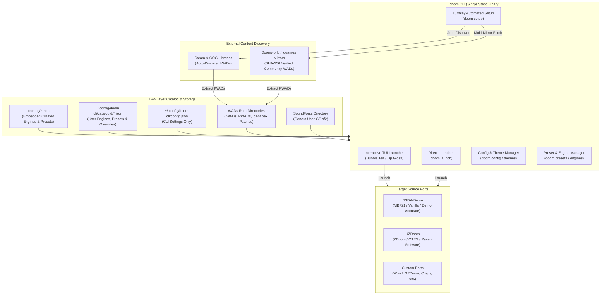

# Contributing to doom-cli

Thank you for your interest in contributing to `github.com/lock14/doom-cli`! This document outlines our
repository standards, architectural guidelines, modular package layout, development workflow, testing requirements,
and pull request conventions.

---

## 1. Repository Design Principles

All contributions must respect our core foundational principles:

*   **Declarative Entity Catalog & Single Source of Truth**: All curated engine and preset definitions, IWAD mappings,
    PWAD file lists, DeHackEd orderings, metadata, and download URLs are defined one entity per file in
    [`catalog/`](catalog/) (`engine.<id>.json` and `preset.<id>.json`) and embedded directly via the root [`embed.go`](embed.go).
    Use `doom presets lint` to validate schema and invariants, and `doom presets build` to synchronize `README.md`.
*   **Portability & Path Invariants**:
    *   **Never commit personal user paths, display resolutions, or refresh rates**: Do not commit paths like
        `/home/<user>/`, hardcoded display resolutions, or fixed monitor refresh rates into configurations, presets,
        or code.
    *   **Use Placeholder Tokens**: Use `__RESOLUTION__`, `__REFRESH_RATE__`, and `__SOUNDFONT__` in
        engine configuration templates (`dsda-doom/dsda-doom.cfg`, `uzdoom/autoexec.cfg`). The CLI deployment tooling
        dynamically substitutes these based on runtime display and filesystem detection.
    *   **Standard Directory Structures**: Respect platform standard directories (XDG on Linux,
        `~/Library/Application Support/` on macOS, and `%LOCALAPPDATA%`/`%USERPROFILE%\Games\Doom\` on Windows).
*   **Destructive Safety & Backup Policy**: Any configuration or catalog write (`doom config install`, `doom setup`,
    `doom engines add`, `doom presets add`, `doom presets config`) must write atomically via same-directory temp rename
    and generate non-clobbering timestamped backups (`.bak.<timestamp>`) before overwriting any existing user file.
*   **Archive Security & Zip Slip Hardening**: All archive extractions (`archive/zip`) and relative sub-path resolutions
    must sanitize entry paths against `..` traversal sequences via `fsutil.SafeJoin` and verify containment before any
    filesystem write.
*   **Doom Engine Selection & Preset Hygiene**:
    *   **DSDA-Doom**: Use for classic vanilla, Boom, MBF, and MBF21 maps where demo accuracy, standard physics,
        and speedrunning precision are desired (e.g., *Alien Vendetta*, *BTSX*, *Sunder*, *Sunlust*, *Legacy of Rust*,
        *Sigil*).
    *   **UZDoom**: Use for mapsets requiring ZDoom/GZDoom scripting, high-res texture packs like OTEX
        (*Eviternity I & II*), or Raven Software games (*Heretic*, *Hexen*).
    *   **No Duplicate IWADs**: Never include the base game IWAD in `files`. The IWAD must only be specified in `iwad`.
    *   **Filename Normalization & Alias Tolerance**: Maintain case-insensitive and dash/underscore/space-tolerant
        file resolution so maps and DeHackEd patches resolve reliably regardless of user file naming.
    *   **Two-Layer Catalog**: Curated defaults in `catalog/*.json` are immutable; user engines, presets, and overrides
        layer cleanly as individual drop-in files in `<ConfigDir>/catalog.d/*.json`, while `<ConfigDir>/config.json`
        stores CLI settings only.

---

## 2. Architecture & Modular Package Layout



The repository features a unified, zero-dependency Go CLI (`doom`) that compiles to a single static binary:

```
doom-cli/
├── embed.go                # Single root embed.FS (catalog/*.json, dsda-doom/*.cfg, uzdoom/*.cfg)
├── catalog/                # One-entity-per-file curated catalog (engine.<id>.json, preset.<id>.json)
├── cmd/doom/               # Command-line interface definitions using Cobra
│   ├── main.go             # Entrypoint, root command, global flags, path & catalog helpers
│   ├── play.go             # 'doom play' interactive launcher with Bubble Tea
│   ├── launch.go           # 'doom launch' direct preset execution command
│   ├── setup.go            # 'doom setup' turnkey installation workflow
│   ├── wads.go             # 'doom wads' subcommands (list, fetch, extract-steam)
│   ├── engines.go          # 'doom engines' subcommands (list, add, remove, install)
│   ├── presets.go          # 'doom presets' subcommands (list, show, add, config, remove, build, lint)
│   ├── soundfont.go        # 'doom soundfont install' subcommand
│   ├── config.go           # 'doom config' subcommands (show, get, set, toggle, install, diff, sync)
│   └── themes.go           # 'doom themes' subcommands (list, set)
├── internal/
│   ├── config/             # Cross-platform path resolution and settings-only config.json
│   ├── display/            # Native display resolution and refresh rate auto-detection
│   ├── engine/             # Source port runners, argument synthesis, declarative binary installers
│   │   ├── runner.go       # Synthesizes arguments and executes engine processes
│   │   └── installer.go    # Declarative GitHub release & pinned fallback binary installer
│   ├── fsutil/             # Atomic file writes (.doom-tmp-* -> rename), backups, and SafeJoin
│   ├── preset/             # Two-layer entity catalog, store, linter, file resolver, README compiler
│   │   ├── preset.go       # Entity models, strict decoding, layered catalog loader, quarantine
│   │   ├── store.go        # User catalog.d write operations (AddEngine, AddPreset, ConfigPreset)
│   │   ├── lint.go         # Schema, invariant, personal-path, and README parity linter
│   │   ├── resolve.go      # Multi-root DirIndex, relative sub-path & 1-level subdir resolution
│   │   ├── decode.go       # Robust text decoding with CP437/DOS box-drawing character detection
│   │   └── compiler.go     # Synchronizes curated catalog/*.json into README.md
│   ├── steam/              # Steam/GOG library discovery (libraryfolders.vdf) and game file extraction
│   ├── templates/          # Embedded engine configuration templates and backup deployer
│   ├── tui/                # Terminal user interface components powered by Bubble Tea and Lip Gloss
│   │   ├── launcher.go     # Bubble Tea state machine, update loop, and message routing
│   │   ├── layout.go       # Dynamic viewport and responsive pane geometry calculations
│   │   ├── render.go       # Split-pane UI rendering, badges, status lines, and key help formatting
│   │   ├── menu.go         # Fallback numbered terminal menu for basic or non-TTY environments
│   │   ├── theme.go        # Theme loading, custom JSON theme decoding, and ANSI/TrueColor styles
│   │   └── builtin_themes.go # Curated color palettes adhering to the 60-30-10 design principle
│   └── wad/                # WAD downloading, archive extraction, and SoundFont deployment
│       ├── downloader.go   # Multi-mirror SHA-256 verified downloader for community megawads
│       ├── extract.go      # Zip Slip hardened archive extraction and DeHackEd/BEX ordering
│       └── soundfont.go    # Roland SC-55 SoundFont installer
├── dsda-doom/              # DSDA-Doom configuration template with placeholder tokens
└── uzdoom/                 # UZDoom autoexec configuration template with placeholder tokens
```

---

## 3. Developer How-To Guides

### Adding or Promoting a Curated Preset

Because user entities in `<ConfigDir>/catalog.d/preset.<id>.json` share the exact same schema as curated entities in `catalog/preset.<id>.json`, you can test a new preset locally and promote it directly into the repository:

1. Add and test the preset locally using the CLI, or create `catalog/preset.<id>.json` directly:
   ```json
   {
     "schema_version": 1,
     "kind": "preset",
     "id": "my-mapset",
     "name": "My Mapset",
     "engine": "dsda-doom",
     "iwad": "DOOM2.WAD",
     "files": [
       { "name": "mymap.wad" },
       { "name": "mymap.deh" },
       { "name": "idkfa 2024.wad", "optional": true }
     ],
     "category": "Community Megawad",
     "compatibility": "Boom",
     "description": "Short description of the mapset and compatibility",
     "author": "Author Name",
     "release_date": "2024",
     "sources": [
       {
         "url": "https://youfailit.net/pub/idgames/levels/doom2/Ports/m-o/mymap.zip"
       }
     ],
     "links": [
       {
         "url": "https://www.doomworld.com/idgames/levels/doom2/Ports/m-o/mymap",
         "rel": "idgames"
       }
     ],
     "sort": 330
   }
   ```
   - **Promote from `catalog.d`**:
     ```bash
     cp ~/.config/doom-cli/catalog.d/preset.my-mapset.json catalog/preset.my-mapset.json
     ```
     Then ensure `author`, `release_date`, `category`, and a unique positive `sort` integer (spaced by 10s in display order) are set.
   - **Important**: Do not include the base game IWAD in `files`.
   - **Important**: Every `sources[].url` must use `https://` and end in `.zip`, `.wad`, or `.pk3`; Doomworld web pages belong in `links[]` with `"rel": "idgames"`.
2. Synchronize the `README.md` preset table and run the catalog linter:
   ```bash
   go run ./cmd/doom presets build
   go run ./cmd/doom presets lint
   ```
3. Verify catalog invariant tests pass:
   ```bash
   go test -v -race ./internal/preset/...
   ```

### Adding or Promoting a Curated Engine

1. Create `catalog/engine.<id>.json` (or copy from `~/.config/doom-cli/catalog.d/engine.<id>.json`) with `kind: "engine"`, `id`, `display_name`, `description`, `family`, `args_style` (`"boom"` or `"zdoom"`), `binary`, `badge`, and optional `install` recipe.
2. Run `go run ./cmd/doom presets lint` and `go test -v -race ./...`.

### Adding a Built-in Theme

1. Open `internal/tui/builtin_themes.go`.
2. Define a new `ThemePalette` entry in `BuiltinThemes`:
   - Follow the **60-30-10 design principle**:
     - 60% Canvas Neutral (`text_primary`, `text_muted`, background)
     - 30% Structural Framing (`border`, `border_focus`, tags)
     - 10% Focused Accent (`accent_primary`, `accent_secondary`, `cursor_bg`, `cursor_fg`)
   - Ensure high contrast for readability across dark terminal backgrounds.
3. Update the theme list in `README.md` and `llms.txt`.
4. Test with:
   ```bash
   go run ./cmd/doom themes list
   go run ./cmd/doom play --theme <new_theme>
   ```

### Archive Security (Zip Slip & Path Containment)

When extracting archives (`archive/zip`) or joining relative paths under a root directory, always use `fsutil.SafeJoin(root, rel)` or verify containment against `filepath.Clean(targetDir) + string(filepath.Separator)` before any filesystem write.

---

## 4. Development Setup & Makefile Targets

### Prerequisites

*   Go 1.27.0 or higher
*   GNU Make
*   Git

### Developer Makefile Targets

We maintain a streamlined `Makefile` for developer verification and local builds:

| Target | Command | Description |
| :--- | :--- | :--- |
| `make build` | `go build -o bin/doom ./cmd/doom` | Compiles the `bin/doom` static binary |
| `make install` | `cp bin/doom $(PREFIX)/doom` | Builds and installs binary to `~/.local/bin/doom` |
| `make test` | `go test -v -race -shuffle=on ./...` | Runs test suite under race detector with randomized order |
| `make bench` | `go test -bench=. -benchmem ./...` | Runs performance benchmarks with allocation tracking |
| `make lint` | `go vet && revive` | Performs static analysis via `go vet` and Revive |
| `make format` | `gofmt -s -w .` | Simplifies and formats all Go source files |
| `make tidy` | `go mod tidy && git diff` | Tidies and verifies `go.mod` and `go.sum` hygiene |
| `make check` | Full test & lint pipeline | Runs formatting, tidy, linters, tests, and path invariant audit |
| `make clean` | `rm -rf bin` | Cleans temporary build artifacts |
| `make help` | Target list | Displays available developer targets |

---

## 5. Go Code Style & Quality Standards

*   **Formatting**: Always format code using `gofmt -s -w .` (simplifying slice and composite literal syntax).
*   **Maximum Line Length (120 Columns)**: Enforce a strict 120-character maximum line length limit across the
    repository via `.editorconfig` and Revive's `line-length-limit` rule in `revive.toml`. Long strings, command
    invocations, and error messages must be wrapped cleanly.
*   **Receiver Naming**: Use short (1-2 letters), mnemonic receiver names consistently across methods on a type.
    Never use `this` or `self`.
*   **Avoid Identifier Shadowing**: Never shadow Go built-in identifiers (`min`, `max`, `len`, `cap`, `new`,
    `clear`, `copy`, `close`, `delete`). Use descriptive identifiers such as `maxVal`, `count`, or `limit`.
*   **Documentation Comments**: All exported packages, types, interfaces, constants, and functions must have
    comprehensive Go doc comments starting with the symbol name and adhering to standard Go and `revive` conventions.
*   **Static Analysis**: Code must pass `go vet ./...` and `revive -config revive.toml -formatter friendly ./...`
    with zero warnings.

---

## 6. Testing Conventions

*   **Table-Driven Tests**: Use table-driven tests for unit testing with descriptive test case names.
*   **Hardened Concurrency & Randomization**: All tests must pass cleanly under `-race` (race detector) and
    `-shuffle=on` (test order randomization).
*   **Filesystem Isolation**: File resolution, deployment, and extraction tests must execute within isolated
    temporary directories (`t.TempDir()` or `os.MkdirTemp`) and clean up completely.
*   **Catalog Lint & Path Invariant Test**: Every test run includes automated validation that:
    1. Curated entities in `catalog/*.json` pass strict schema validation and synchronize with `README.md`.
    2. Zero absolute personal user paths exist in configuration files, catalog entities, or test fixtures.

---

## 7. Documentation Boundaries & Synchronization

*   **`README.md` is for Users**: Focuses strictly on user-facing installation, directory layouts, preset catalogs,
    visual profiles, and `doom` CLI usage. Must **not** contain internal developer commands or compiler details.
*   **`CONTRIBUTING.md` is for Contributors**: Covers developer setup, `make` targets, code style, modular package
    maps, how-to guides, and PR guidelines.
*   **`AGENTS.md` is for Agents & Core Architecture**: Encodes canonical design invariants, path tokens, safety
    rules, and automated verification checklists.
*   **Mandatory Synchronization**: Whenever presets, engine settings, build targets, directory layouts, or CLI
    mechanics are modified, all relevant documentation (**Go doc comments**, **`README.md`**, **`CONTRIBUTING.md`**,
    **`AGENTS.md`**, and **`llms.txt`**) MUST be updated within the same pull request.

---

## 8. Pre-Completion Verification Checklist

Before opening a pull request or submitting code, verify that `make check` succeeds completely:

```bash
# 1. Format check
make format-check

# 2. Module hygiene check
make tidy-check

# 3. Static analysis & linting
make lint

# 4. Full validation suite (tests with -race and -shuffle=on, catalog lint, path invariants)
make check
```

---

## 9. Pull Request Guidelines

1. **Descriptive Commits**: Use clean, imperative commit messages
   (e.g., `Add Sigil II preset and configure DSDA-Doom mapping`).
2. **Path Audit**: Verify `git diff` contains zero hardcoded personal user paths or usernames before committing.
3. **PR Template**: Complete all sections of the [Pull Request Template](.github/PULL_REQUEST_TEMPLATE.md) including
   the design and verification checklists.
