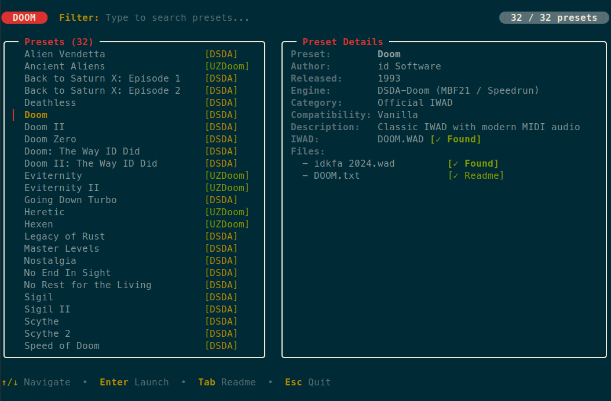
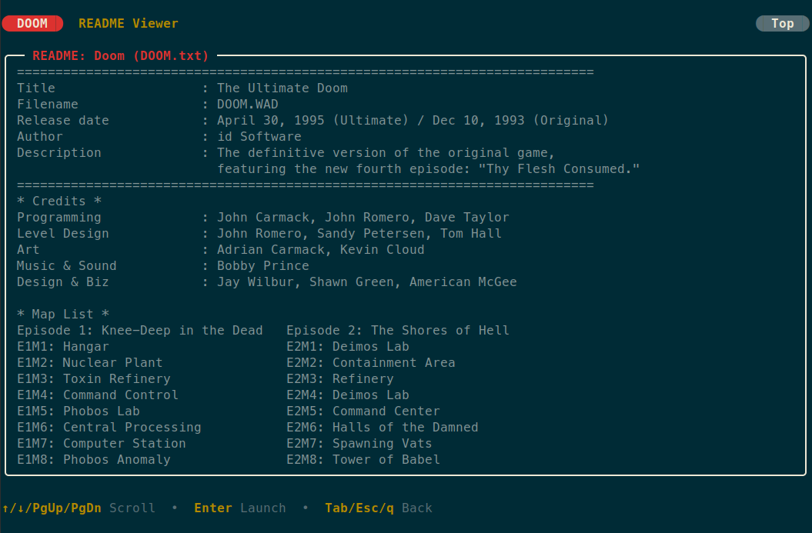

# doom-cli

[](https://go.dev/)
[](https://github.com/lock14/doom-cli/actions/workflows/ci.yml)
[](https://github.com/lock14/doom-cli/actions/workflows/benchmark.yml)
[](https://github.com/lock14/doom-cli/actions/workflows/security.yml)
[](https://codecov.io/gh/lock14/doom-cli)
[](LICENSE)

A unified, cross-platform CLI tool and curated collection of configurations and launcher presets for classic Doom source ports ([DSDA-Doom](https://github.com/kraflab/dsda-doom) and [UZDoom](https://github.com/UZDoom/uzdoom)) across Linux, macOS, and Windows.

## Table of contents

- [Quick start](#quick-start)
- [Installation](#installation)
  - [Linux and macOS](#linux-and-macos)
  - [Windows](#windows)
- [Automated setup (`doom setup`)](#automated-setup-doom-setup)
- [CLI command reference](#cli-command-reference)
  - [Core commands](#core-commands)
  - [Engine management](#engine-management)
  - [Preset and custom WAD management](#preset-and-custom-wad-management)
  - [WADs and expansion management](#wads-and-expansion-management)
  - [SoundFont management](#soundfont-management)
  - [Configuration management](#configuration-management)
  - [Themes and styling](#themes-and-styling)
  - [Shell autocompletion](#shell-autocompletion)
- [Interactive TUI launcher](#interactive-tui-launcher)
  - [Main preset browser controls](#main-preset-browser-controls)
  - [README document viewer controls](#readme-document-viewer-controls)
- [Themes and visual customization](#themes-and-visual-customization)
  - [Built-in themes](#built-in-themes)
  - [Custom JSON themes](#custom-json-themes)
  - [Nerd Fonts and capsule badges](#nerd-fonts-and-capsule-badges)
- [Extensibility](#extensibility)
  - [Add custom engines](#add-custom-engines)
  - [Add custom WADs and presets](#add-custom-wads-and-presets)
  - [Configure per-WAD launch options](#configure-per-wad-launch-options)
- [Configuration and user catalog schema](#configuration-and-user-catalog-schema)
  - [CLI settings (`config.json`)](#cli-settings-configjson)
  - [Persistent directory overrides](#persistent-directory-overrides)
  - [User entity catalog (`catalog.d/*.json`)](#user-entity-catalog-catalogdjson)
- [Environment variables](#environment-variables)
- [Directory layouts](#directory-layouts)
- [Game files and content setup](#game-files-and-content-setup)
- [Preconfigured presets](#preconfigured-presets)
- [Engine profiles and customizations](#engine-profiles-and-customizations)
  - [UZDoom ("Software-Plus" profile)](#uzdoom-software-plus-profile)
  - [DSDA-Doom (speedrunning and demo accuracy)](#dsda-doom-speedrunning-and-demo-accuracy)
- [Source port packaging (Linux)](#source-port-packaging-linux)
- [Troubleshooting and FAQ](#troubleshooting-and-faq)
- [Contributing](#contributing)
- [Security](#security)
- [License](#license)

## Quick start

Get from zero to playing classic Doom in three commands:

```bash
# 1. Install doom CLI to ~/.local/bin/doom
make install

# 2. Run turnkey setup (downloads engines, configs, soundfont, Steam IWADs, and megawads)
doom setup

# 3. Launch the interactive preset browser
doom play
```

## Installation

### Linux and macOS

```bash
# Clone the repository
git clone https://github.com/lock14/doom-cli.git
cd doom-cli

# Compile and install the static doom binary to ~/.local/bin/doom
make install
```

Alternatively, install directly via Go with `go install github.com/lock14/doom-cli/cmd/doom@latest`.

> [!TIP]
> Ensure `~/.local/bin` is in your `$PATH` (for example, in `~/.bashrc` or `~/.zshrc`):
> ```bash
> export PATH="$HOME/.local/bin:$PATH"
> ```

### Windows

In PowerShell or Windows Terminal:

```powershell
# Clone the repository
git clone https://github.com/lock14/doom-cli.git
cd doom-cli

# Compile doom.exe to your Go bin path
go install ./cmd/doom

# Or compile directly to a dedicated binary folder:
go build -o $HOME/bin/doom.exe ./cmd/doom
```

## Automated setup (`doom setup`)

Configure engines, templates, audio, and game files in a single step:

```bash
doom setup
```

`doom setup` performs five automated steps:
1. **Installs source ports**: Downloads portable binaries for UZDoom and DSDA-Doom into your local binary path.
2. **Deploys engine configurations**: Installs curated configurations for UZDoom and DSDA-Doom, auto-detecting your display resolution and native monitor refresh rate while creating timestamped backups (`.bak.<timestamp>`) of any existing files.
3. **Deploys MIDI SoundFont**: Downloads and installs the Roland SC-55 SoundFont (`GeneralUser-GS.sf2`) for FluidSynth MIDI playback.
4. **Extracts official game files**: Scans Steam and GOG library folders across drives for *Doom + Doom II (2024)*, *Heretic*, and *Hexen*, importing commercial IWADs and the `idkfa 2024.wad` soundtrack into your WADs directory.
5. **Downloads community megawads**: Fetches and extracts free community megawads (*Eviternity I & II*, *Back to Saturn X*, *Ancient Aliens*, *Doom Zero*, *Sunder*, *Sunlust*, and others) and DeHackEd patches from idgames, DSDA, and community mirrors.

## CLI command reference

The `doom` CLI provides modular commands for granular management:

### Core commands

| Command | Description |
| :--- | :--- |
| `doom` or `doom play` | Launches the interactive TUI fuzzy launcher |
| `doom play --once` | Launches the TUI, runs the selected preset, and exits without returning to the launcher |
| `doom play --theme <name>` | Runs the TUI with a specific color theme for the current session |
| `doom play --nerd-fonts` | Enables Powerlevel10k rounded capsule badges for the current session |
| `doom launch <preset> [flags]` | Directly launches a preset by ID, name, or prefix with optional engine flags |
| `doom launch <preset> --dry-run` | Prints the synthesized launch command without starting the game |
| `doom setup` | Runs turnkey installation of engines, configurations, SoundFonts, and game files |

### Engine management

| Command | Description |
| :--- | :--- |
| `doom engines` or `doom engines list` | Lists all configured engines (built-in and custom) with binary status |
| `doom engines add <name> [flags]` | Registers a custom source port engine in `catalog.d/engine.<id>.json` |
| `doom engines remove <name>` | Removes a custom engine from your user catalog |
| `doom engines install [engine\|all]` | Downloads and installs portable binaries for `uzdoom` and `dsda-doom` |
| `doom engines install --force` | Re-downloads and overwrites existing engine binaries |

### Preset and custom WAD management

| Command | Description |
| :--- | :--- |
| `doom presets` or `doom presets list` | Lists all presets (built-in and custom) with engine badges and descriptions |
| `doom presets show <name>` | Displays resolved engine, IWAD, PWADs, sources, links, and file status |
| `doom presets add <name> [flags]` | Registers a custom WAD or mapset preset in `catalog.d/preset.<id>.json` |
| `doom presets config <name> [flags]` | Sets per-WAD overrides in `catalog.d/override.preset.<id>.json` |
| `doom presets config <name> --reset` | Clears custom launch overrides, reverting to curated defaults |
| `doom presets remove <name>` | Removes a custom preset or clears overrides for a built-in preset |
| `doom presets lint` | Validates curated and user catalog entities and schema invariants |

### WADs and expansion management

| Command | Description |
| :--- | :--- |
| `doom wads list` | Lists downloadable community megawads and expected files |
| `doom wads fetch [preset\|all]` | Downloads and extracts community megawads from idgames mirrors |
| `doom wads fetch --force` | Re-downloads and overwrites existing WAD files |
| `doom wads extract` | Auto-discovers and imports official Steam and GOG commercial IWADs |
| `doom wads extract --force` | Re-extracts and overwrites existing IWADs in the destination directory |

The `doom wads extract-steam` command is an alias for `doom wads extract`.

### SoundFont management

| Command | Description |
| :--- | :--- |
| `doom soundfont install` | Downloads and deploys the Roland SC-55 SoundFont (`GeneralUser-GS.sf2`) |
| `doom soundfont install --force` | Re-downloads and overwrites an existing SoundFont file |

### Configuration management

| Command | Description |
| :--- | :--- |
| `doom config show` | Displays active CLI user configuration (`config.json`) |
| `doom config get <key>` | Retrieves a specific configuration value (such as `doom config get theme`) |
| `doom config set <key> <val>` | Sets a configuration value (such as `doom config set nerd-fonts on`) |
| `doom config toggle <key>` | Toggles a boolean setting (such as `doom config toggle nerd-fonts`) |
| `doom config install` | Deploys source port configuration files with display auto-detection and backups |
| `doom config diff` | Shows differences between repository templates and live installed configurations |
| `doom config sync` | Pulls live tweaks (keybindings, sensitivity) from the host system back into the repository |

### Themes and styling

| Command | Description |
| :--- | :--- |
| `doom themes` or `doom themes list` | Lists all built-in and custom themes with live ANSI color swatches |
| `doom themes set <theme>` | Sets the default launcher theme in user configuration |

### Shell autocompletion

Generate shell completion scripts dynamically:

```bash
# Bash
doom completion bash | sudo tee /etc/bash_completion.d/doom > /dev/null

# Zsh
doom completion zsh > "${fpath[1]}/_doom"

# Fish
doom completion fish > ~/.config/fish/completions/doom.fish

# PowerShell
doom completion powershell | Out-String | Invoke-Expression
```

## Interactive TUI launcher

The interactive launcher (`doom play` or `doom`) provides a responsive, split-pane terminal interface powered by Bubble Tea:



- **Fuzzy search**: Type characters to filter presets immediately by name, engine, or category, use `Home` and `End` to move the filter text cursor, use `↑`, `Ctrl+P`, or `Ctrl+K` and `↓`, `Ctrl+N`, or `Ctrl+J` to move the selection cursor, page through the preset list with `PgUp` or `Ctrl+U` and `PgDn` or `Ctrl+D`, and press `Enter` to launch the selected preset.
- **Side-by-side preview pane**: Displays the required IWAD, PWAD file list, DeHackEd patches, launch arguments, and release metadata.
- **File readiness indicators**: Displays `[✓ Found]` when required files resolve on disk, `[✗ Missing]` when required files are absent, and `[Optional]` when optional files are absent.
- **In-app README viewer**: Press `Tab` or `Ctrl+R` on any preset to read its bundled idgames `.txt` documentation in a scrollable viewport with automatic CP437 box-drawing decoding.
- **Session memory**: Preserves cursor selection across launches when returning to the browser, and exits cleanly with `Esc` or `Ctrl+C`. Configure color themes and Nerd Fonts badges via `--theme`, `--nerd-fonts`, `doom themes set`, or `doom config`.

### Main preset browser controls

| Key | Action |
| :--- | :--- |
| Character keys | Filter presets immediately by name, engine, or category |
| `Home` or `End` | Move text cursor to start or end of filter input |
| `↑`, `Ctrl+P`, or `Ctrl+K` | Move selection up |
| `↓`, `Ctrl+N`, or `Ctrl+J` | Move selection down |
| `PgUp` or `Ctrl+U` | Move selection up one page or half page |
| `PgDn` or `Ctrl+D` | Move selection down one page or half page |
| `Enter` | Launch selected preset |
| `Tab` or `Ctrl+R` | Open bundled README in document viewer |
| `Esc` or `Ctrl+C` | Quit launcher |

### README document viewer controls



When viewing a preset's documentation via `Tab` or `Ctrl+R`, scroll line-by-line with `↑` or `k` and `↓` or `j`, page through with `PgUp`, `b`, `u`, `Ctrl+U`, `PgDn`, `f`, `d`, `Space`, or `Ctrl+D`, jump to the top or bottom with `g`, `Home`, `G`, or `End`, press `Enter` to launch the selected preset, or press `Tab`, `Ctrl+R`, `Esc`, `q`, or `Q` to return to the preset list:

| Key | Action |
| :--- | :--- |
| `↑` or `k` | Scroll up one line |
| `↓` or `j` | Scroll down one line |
| `PgUp`, `b`, `u`, or `Ctrl+U` | Scroll up one page or half page |
| `PgDn`, `f`, `d`, `Space`, or `Ctrl+D` | Scroll down one page or half page |
| `g` or `Home` | Jump to top of document |
| `G` or `End` | Jump to bottom of document |
| `Enter` | Launch selected preset |
| `Tab`, `Ctrl+R`, `Esc`, `q`, or `Q` | Close document viewer and return to preset list |
| `Ctrl+C` | Quit launcher |

## Themes and visual customization

The interactive launcher uses a semantic color system adhering to the 60-30-10 terminal design principle (60% canvas neutral, 30% structural framing, 10% focused accent) for contrast across dark and light terminals:

```bash
# List all themes with live terminal color swatches
doom themes list

# Persistently set default theme
doom themes set blood

# Temporarily test a theme for a single run
doom play --theme toxic
```

### Built-in themes

| Theme | Type | Description |
| :--- | :--- | :--- |
| `classic` | ANSI-16 | Classic Doom semantic ANSI palette that adapts to terminal colors (`default`) |
| `blood` | TrueColor | Gothic crimson (`#9B111E`) and bone white Nightdive software-plus palette |
| `toxic` | TrueColor | Radioactive nukage green (`#70E000`) and hazard amber (`#FFB703`) Phobos techbase palette |
| `inferno` | TrueColor | Volcanic molten magma (`#FF5400`) and charred basalt Episode 3 palette |
| `frost` | TrueColor | Glacial cyan (`#56CFE1`) and midnight polar navy Cocytus palette |
| `plasma` | TrueColor | Plasma rifle electric cyan (`#05D9E8`) and neon pink (`#FF2A6D`) |
| `heretic` | TrueColor | Raven Software dark fantasy amethyst (`#BD93F9`) and emerald (`#50FA7B`) |
| `amber` | TrueColor | Vintage 1980s DEC VT220 and Hercules warm amber phosphor CRT monitor (`#FFB000`) |
| `sigil` | TrueColor | Romero velvet maroon (`#5E0B15`) and pentagram red (`#D90429`) |
| `monochrome` | ANSI | High-contrast black and white for monochrome terminals |

### Custom JSON themes

Create custom themes in `<config_dir>/themes/<theme_name>.json` (for example, `~/.config/doom-cli/themes/solarized.json`):

```json
{
  "name": "solarized",
  "description": "Solarized dark palette",
  "brand_cap": "#CB4B16",
  "brand_text": "#FDF6E3",
  "brand_bg": "#CB4B16",
  "stats_cap": "#073642",
  "stats_text": "#93A1A1",
  "stats_bg": "#073642",
  "prompt": "#268BD2",
  "cursor_bar": "#268BD2",
  "cursor_text": "#FDF6E3",
  "border_active": "#268BD2",
  "border_inactive": "#073642",
  "title_active": "#268BD2",
  "title_inactive": "#586E75",
  "label": "#2AA198",
  "keycap": "#B58900",
  "key_desc": "#586E75",
  "tag_dsda": "#859900",
  "tag_uzdoom": "#B58900",
  "status_ready": "#859900",
  "status_missing": "#DC322F",
  "muted": "#586E75"
}
```

Theme resolution follows a four-step precedence order:
1. `--theme <name>` CLI flag
2. `DOOM_THEME` environment variable
3. `theme` setting in user configuration (`config.json`)
4. `default` built-in theme

### Nerd Fonts and capsule badges

By default, the launcher uses universal rectangular badges (` DOOM `) and standard text prompts (`Filter: `), rendering cleanly in standard terminal emulators without patched fonts.

If your terminal font includes Nerd Fonts glyphs (such as JetBrains Mono NF, MesloLGS NF, or FiraCode NF), you can enable Powerlevel10k-style rounded capsule badges (` DOOM `):

```bash
# Enable temporarily for one session
doom play --nerd-fonts

# Permanently toggle in user configuration
doom config toggle nerd-fonts
doom config set nerd-fonts on
```

## Extensibility

`doom-cli` uses a two-layer entity catalog: immutable curated defaults embedded from `catalog/*.json` and per-entity user drop-in files in `<config_dir>/catalog.d/*.json`.

### Add custom engines

Register any source port installed on your system (such as Woof!, Crispy Doom, GZDoom, or PrBoom+):

```bash
# Add Woof! source port (Boom argument style with -file and -deh)
doom engines add "Woof!" --id woof --binary woof --style boom --description "Woof! MBF21 port"

# Add GZDoom pointing to an explicit binary path
doom engines add "GZDoom" --id gzdoom --binary /usr/bin/gzdoom --style zdoom --description "GZDoom OpenGL and Vulkan"

# List all available engines and verify binary availability
doom engines list
```

### Add custom WADs and presets

Add custom mapsets or community mods to your personal catalog (`catalog.d/preset.<id>.json`). They integrate into `doom play` fuzzy search and direct execution (`doom launch`):

```bash
# Add a custom mapset with required IWAD and PWADs
doom presets add "KDiZD" --engine uzdoom --iwad DOOM.WAD --files "kdizd_12.pk3" --description "Knee-Deep in ZDoom"

# Inspect preset details and missing file status
doom presets show "KDiZD"

# Launch your custom preset
doom launch "KDiZD"
```

### Configure per-WAD launch options

Customize launch preferences for any WAD (`catalog.d/override.preset.<id>.json`) without modifying repository defaults:

```bash
# Always launch Sunlust in Woof! with ultra-violence skill
doom presets config "Sunlust" --engine woof --args "-skill 4"

# Set Ancient Aliens to always run with Boom complevel 11
doom presets config "Ancient Aliens" --args "-complevel 11"

# Reset custom launch options back to curated defaults
doom presets config "Sunlust" --reset
```

## Configuration and user catalog schema

### CLI settings (`config.json`)

User settings are persisted in `~/.config/doom-cli/config.json` (Linux), `~/Library/Application Support/doom-cli/config.json` (macOS), or `%LOCALAPPDATA%\doom-cli\config.json` (Windows):

```json
{
  "theme": "blood",
  "nerd_fonts": false,
  "wads_dir": "E:\\DOOM\\WADS",
  "wads_dirs": [
    "E:\\DOOM\\MEGAWADS"
  ],
  "bin_dir": "E:\\DOOM\\bin",
  "soundfonts_dir": "E:\\DOOM\\soundfonts"
}
```

### Persistent directory overrides

Set default directories permanently in `config.json` without needing CLI flags or environment variables:

```bash
# Set custom WADs directory permanently
doom config set wads-dir "E:\DOOM\WADS"

# Configure additional read-only WAD search roots
doom config set wads-dirs "E:\DOOM\MEGAWADS,E:\DOOM\MODS"

# Set custom engine binaries directory permanently
doom config set bin-dir "E:\DOOM\bin"

# Set custom SoundFonts directory permanently
doom config set soundfonts-dir "E:\DOOM\soundfonts"

# Display all current configuration settings
doom config show
```

### User entity catalog (`catalog.d/*.json`)

Custom engines, presets, and overrides are stored one entity per file inside `<config_dir>/catalog.d/`:

- `catalog.d/engine.woof.json`:
  ```json
  {
    "schema_version": 1,
    "kind": "engine",
    "id": "woof",
    "display_name": "Woof!",
    "description": "Woof! MBF21 port",
    "args_style": "boom",
    "binary": "woof"
  }
  ```
- `catalog.d/preset.kdizd.json`:
  ```json
  {
    "schema_version": 1,
    "kind": "preset",
    "id": "kdizd",
    "name": "KDiZD",
    "engine": "uzdoom",
    "iwad": "DOOM.WAD",
    "files": [
      { "name": "kdizd_12.pk3" }
    ],
    "category": "Custom",
    "description": "Knee-Deep in ZDoom"
  }
  ```
- `catalog.d/override.preset.sunlust.json`:
  ```json
  {
    "schema_version": 1,
    "kind": "override",
    "target": {
      "kind": "preset",
      "id": "sunlust"
    },
    "set": {
      "engine": "woof"
    },
    "append_args": [
      "-skill",
      "4"
    ]
  }
  ```

## Environment variables

Environment variables override persistent settings in `config.json` and platform defaults, while explicit CLI flags (`--theme`, `--wads-dir`, `--bin-dir`, `--soundfonts-dir`) take precedence over environment variables:

| Variable | Description | Default |
| :--- | :--- | :--- |
| `DOOM_THEME` | Color theme for the interactive launcher | `default` (or value in `config.json`) |
| `DOOM_WADS_DIR` or `WADS_DIR` | Primary directory containing game IWADs, PWADs, and DeHackEd patches | Platform standard WAD directory |
| `DOOM_WADS_DIRS` or `WADS_DIRS` | Additional read-only WAD search directories (comma or path-list separated) | `wads_dirs` in `config.json` |
| `DOOM_BIN_DIR` or `BIN_DIR` | Directory containing source port engine binaries | Platform standard binary directory |
| `DOOM_SF_DIR` or `SF_DIR` | Directory containing SoundFonts (`GeneralUser-GS.sf2`) | Platform standard SoundFonts directory |

## Directory layouts

The `doom` CLI uses standard, platform-idiomatic paths:

| Component | Linux (XDG) | macOS | Windows |
| :--- | :--- | :--- | :--- |
| Binaries | `~/.local/bin/` | `~/.local/bin/` | `%USERPROFILE%\Games\Doom\bin\` |
| WADs and mods | `~/.local/share/games/uzdoom/` | `~/Library/Application Support/games/uzdoom/` | `%USERPROFILE%\Games\Doom\wads\` |
| UZDoom configuration | `~/.config/uzdoom/autoexec.cfg` | `~/Library/Application Support/uzdoom/autoexec.cfg` | `%USERPROFILE%\Games\Doom\bin\autoexec.cfg` |
| DSDA-Doom configuration | `~/.local/share/dsda-doom/dsda-doom.cfg` | `~/Library/Application Support/dsda-doom/dsda-doom.cfg` | `%USERPROFILE%\Games\Doom\bin\dsda-doom.cfg` |
| CLI configuration and themes | `~/.config/doom-cli/` | `~/Library/Application Support/doom-cli/` | `%LOCALAPPDATA%\doom-cli\` |
| User catalog | `~/.config/doom-cli/catalog.d/` | `~/Library/Application Support/doom-cli/catalog.d/` | `%LOCALAPPDATA%\doom-cli\catalog.d\` |
| SoundFonts | `~/.local/share/soundfonts/` | `~/Library/Application Support/soundfonts/` | `%USERPROFILE%\Games\Doom\soundfonts\` |

## Game files and content setup

> [!IMPORTANT]
> Commercial game files are not tracked in Git. This repository contains configuration files, launcher presets, and automated fetch tools. You must provide your own legally acquired game files:
> - **Commercial IWADs**: Acquire `DOOM.WAD`, `DOOM2.WAD`, `PLUTONIA.WAD`, `TNT.WAD`, `HERETIC.WAD`, and `HEXEN.WAD` from digital storefronts, and run `doom wads extract` to auto-discover and import them directly from your Steam and GOG libraries:
>   - *Doom + Doom II*: [Steam](https://store.steampowered.com/app/2280/DOOM_DOOM_II/) or [GOG](https://www.gog.com/en/game/doom_doom_ii)
>   - *Heretic + Hexen*: [Steam](https://store.steampowered.com/app/3286930/Heretic__Hexen/) or [GOG](https://www.gog.com/en/game/heretic_hexen)
> - **Community megawads and expansions**: Fetch *Ancient Aliens*, *Eviternity I & II*, *Back to Saturn X*, *Sunlust*, *Sunder*, and other mapsets automatically via `doom wads fetch` or download them from the [Doomworld idgames archive](https://www.doomworld.com/idgames/).

## Preconfigured presets

All presets are declaratively managed in [`catalog/`](catalog/) and mapped to their optimal engine:

| Megawad or expansion | Engine | Compatibility and details |
| :--- | :--- | :--- |
| Alien Vendetta | DSDA-Doom | Classic Boom megawad with DeHackEd patch |
| Ancient Aliens | UZDoom | MBF complevel 11 megawad with custom color palette |
| Back to Saturn X: Episode 1 | DSDA-Doom | Vanilla and Boom megawad with custom soundtrack and palettes |
| Back to Saturn X: Episode 2 | DSDA-Doom | Vanilla and Boom megawad with custom soundtrack and palettes |
| Deathless | DSDA-Doom | Modern Ultimate Doom episode replacement |
| Doom | DSDA-Doom | Classic IWAD with modern MIDI audio |
| Doom II | DSDA-Doom | Classic IWAD with modern MIDI audio |
| Doom Zero | DSDA-Doom | Anniversary megawad with DeHackEd modifications |
| Doom: The Way ID Did | DSDA-Doom | Classic vanilla-style homage megawad |
| Doom II: The Way ID Did | DSDA-Doom | Classic vanilla-style homage megawad |
| Eviternity | UZDoom | OTEX texture pack and custom monsters |
| Eviternity II | UZDoom | OTEX texture pack, MBF21 features, and custom monsters |
| Going Down Turbo | DSDA-Doom | Fast-paced, compact map pack |
| Heretic | UZDoom | Raven Software classic fantasy shooter |
| Hexen | UZDoom | Raven Software hub-based fantasy shooter |
| Legacy of Rust | DSDA-Doom | Official ID24 episode with custom weapons and monsters |
| Master Levels | DSDA-Doom | Full 20-level classic collection |
| Nostalgia | DSDA-Doom | Vanilla-compatible megawad |
| No End In Sight | DSDA-Doom | Classic 4-episode expansion for Ultimate Doom |
| No Rest for the Living | DSDA-Doom | Official 9-level expansion for Doom II |
| Sigil | DSDA-Doom | John Romero's unofficial 5th episode for Ultimate Doom |
| Sigil II | DSDA-Doom | John Romero's unofficial 6th episode for Ultimate Doom |
| Scythe | DSDA-Doom | Iconic fast-paced speedrunning megawad |
| Scythe 2 | DSDA-Doom | Erik Alm's legendary sequel with custom monsters |
| Speed of Doom | DSDA-Doom | 33-level intense challenge megawad |
| Sunder | DSDA-Doom | Monumental architectural slaughter megawad |
| Sunlust | DSDA-Doom | 32-level visual and gameplay masterpiece |
| The Plutonia Experiment | DSDA-Doom | Classic Final Doom IWAD with modern soundtrack |
| Plutonia 2 | DSDA-Doom | Community sequel to The Plutonia Experiment |
| TNT: Evilution | DSDA-Doom | Classic Final Doom IWAD with modern soundtrack |
| TNT: Revilution | DSDA-Doom | Community sequel to TNT: Evilution |
| Valiant | UZDoom | MBF megawad with custom weapons and DeHackEd patch |

## Engine profiles and customizations

### UZDoom ("Software-Plus" profile)

Configured in [`uzdoom/autoexec.cfg`](uzdoom/autoexec.cfg) to reproduce the crisp Nightdive Remaster aesthetic:
- **Software sector lighting**: `gl_lightmode 0` with light stepping (`gl_bandedsw 1`).
- **Tonemapping**: 256-color palette tonemapping (`gl_tonemap 3`).
- **Nearest-neighbor filtering**: Crisp, unblurred pixels (`gl_texture_filter 0`) with 16x anisotropic filtering (`gl_texture_filter_aniso 16`).
- **Remaster HUD and crosshair**: Minimalist widescreen alternate HUD and classic Nightdive green crosshair (`#00FF00`).
- **Audio and quick saves**: High-definition 48 kHz audio sampling, FluidSynth MIDI backend, and `F5` and `F9` quick save and quick load bindings.

### DSDA-Doom (speedrunning and demo accuracy)

Configured in [`dsda-doom/dsda-doom.cfg`](dsda-doom/dsda-doom.cfg):
- **Compatibility**: Default `complevel 21` (MBF21 standard).
- **Video and display**: OpenGL mode with integer scaling, VSync frame pacing, and uncapped high-refresh support (no artificial 60 FPS cap).
- **Extended HUD (exHUD)**: In-game level splits, secret counters, and completion times.
- **Built-in capture**: Ready-to-use `ffmpeg` video recording commands.

## Source port packaging (Linux)

When running Doom source ports on Linux, standalone native binaries or AppImages in `~/.local/bin/` are recommended over sandboxed Flatpaks.

Flatpaks isolate applications from the rest of the filesystem, preventing the launcher (`doom play`) from discovering game engines or accessing WADs across custom paths without manual permission overrides. Running `doom setup` or `doom engines install` automatically manages standalone binaries in your user path.

## Troubleshooting and FAQ

### "Base IWAD not found" error when launching
Ensure commercial IWADs (`DOOM2.WAD`, `DOOM.WAD`, and others) are in your WAD directory (`~/.local/share/games/uzdoom/` on Linux). If you own the game on Steam or GOG, run:
```bash
doom wads extract
```
Or specify a custom WAD directory with `--wads-dir <path>` or `export DOOM_WADS_DIR=<path>`.

### "Engine binary not found in PATH"
Run `doom engines install` to download portable binaries for UZDoom and DSDA-Doom into `~/.local/bin/`, or verify `~/.local/bin` is in your `$PATH`. You can also configure a custom engine with an absolute binary path using `doom engines add <name> --binary /path/to/binary`.

### MIDI music is silent or failing to initialize
Verify FluidSynth SoundFont deployment:
```bash
doom soundfont install
```
Ensure `GeneralUser-GS.sf2` is present in `~/.local/share/soundfonts/`.

### Display resolution or refresh rate mismatch
When switching monitors, re-detect native display resolution and refresh rate by running:
```bash
doom config install
```
This updates `screen_resolution` in `dsda-doom.cfg` and `vid_maxfps` in `autoexec.cfg` while creating timestamped backups of your prior configurations.

## Contributing

Review the [contributing guidelines](CONTRIBUTING.md) for architecture details, development setup, code style, and pull request verification instructions.

## Security

Report security issues privately according to the [security policy](SECURITY.md).

## License

Apache 2.0. See [LICENSE](LICENSE).
